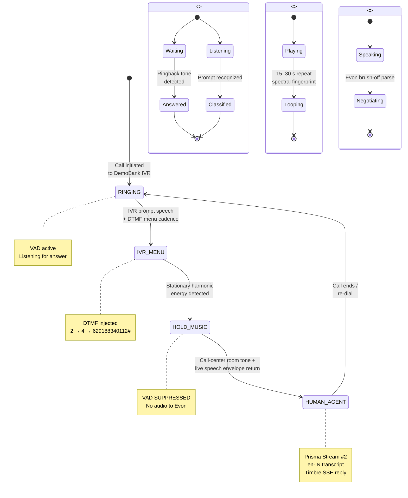

# docs/system_diagrams.md — HaqVaani System Diagrams (Mermaid)

> All diagrams below are Mermaid flowcharts / state diagrams showing exactly how every node connects.
> Copy any diagram into the [Mermaid Live Editor](https://mermaid.live) to view/edit, or open
> `diagrams_viewer.html` in this folder to render them all in one page.

---

## 1. End-to-End 7-Stage Pipeline

```mermaid
flowchart TD
    %% Styling
    classDef citizen fill:#1a1a2e,stroke:#00f2ff,stroke-width:2px,color:#fff
    classDef gnani fill:#16213e,stroke:#7c3aed,stroke-width:2px,color:#fff
    classDef bank fill:#0d1b2a,stroke:#ffb020,stroke-width:2px,color:#fff
    classDef safety fill:#1b263b,stroke:#ff4d4d,stroke-width:2px,color:#fff
    classDef output fill:#0f172a,stroke:#00d97a,stroke-width:2px,color:#fff

    Citizen[("Citizen Leg:<br/>8 kHz Noisy<br/>Hinglish /<br/>Regional")]:::citizen

    subgraph DSP["Stage 1 — Telephony DSP"]
        DSP1[8→16 kHz<br/>FIR Resample]
        VAD[Silero VAD<br/>220 ms hangover]
        RB[Ring Buffer<br/>200 ms / 60 ms]
    end

    subgraph STT["Stage 2 — Prisma v2.5 STT"]
        WSS[WebSocket Stream #1<br/>x-format=transcribe<br/>lang_code=hi-IN]
        ITN[Inverse Text<br/>Normalization<br/>Digits → ASCII]
    end

    subgraph STAT["Stage 3 — Statutory Engine"]
        EVON1[Evon v3.3<br/>Intake Parser]
        PY[Pure Python<br/>compute_statutory_entitlement<br/>T+1 / T+5 / ₹100/day]
    end

    subgraph ORCH["Stage 4 — Outbound IVR Orchestrator"]
        FSM[Acoustic State<br/>Classifier<br/>RINGING / IVR_MENU<br/>HOLD_MUSIC / HUMAN_AGENT]
        DTMF[ITU-T Q.23<br/>DTMF Generator<br/>2 → 4 → 629188340112#]
        WSS2[WebSocket Stream #2<br/>en-IN corporate<br/>transcript]
        EVON2[Evon v3.3<br/>Brush-Off &<br/>Docket Parser]
        TIMBRE1[Timbre v2.5/v3.0<br/>SSE en-IN<br/>Disclosure + Citation]
    end

    subgraph VERIFY["Stage 5 — Verbatim Gate"]
        SUBSTR[Substring Verification<br/>Docket ID in<br/>support_transcript]
        GATE[SafetyGuardBlock<br/>Consent + Disclosure<br/>Secret Redaction]
    end

    subgraph CALLBACK["Stage 6 — Citizen Callback"]
        TIMBRE2[Timbre v2.5/v3.0<br/>SSE hi-IN<br/>~8 s warm summary]
    end

    subgraph DOSSIER["Stage 7 — RB-IOS 2026 Dossier"]
        PDF[RB-IOS 2026 CMS<br/>PDF / JSON<br/>cms.rbi.org.in · 14448]
    end

    Citizen --> DSP1
    DSP1 --> VAD
    VAD --> RB
    RB --> WSS
    WSS --> ITN
    ITN --> EVON1
    EVON1 --> PY
    PY --> FSM
    FSM --> DTMF
    DTMF --> WSS2
    WSS2 --> EVON2
    EVON2 --> TIMBRE1
    TIMBRE1 --> SUBSTR
    SUBSTR --> GATE
    GATE --> TIMBRE2
    TIMBRE2 --> PDF

    linkStyle default stroke:#2d3448,stroke-width:2px
    linkStyle 0,1,2 stroke:#00f2ff,stroke-width:3px
    linkStyle 7 stroke:#7c3aed,stroke-width:3px
    linkStyle 12 stroke:#ff4d4d,stroke-width:3px
    linkStyle 15 stroke:#00d97a,stroke-width:3px
```



---

## 2. Acoustic State Machine (Stage 4)



---

## 3. Data Flow Between Modules

```mermaid
flowchart LR
    classDef input fill:#0b101a,stroke:#00f2ff,color:#00f2ff
    classDef process fill:#16213e,stroke:#7c3aed,color:#fff
    classDef store fill:#0d1b2a,stroke:#ffb020,color:#fff
    classDef gate fill:#1b263b,stroke:#ff4d4d,color:#ff4d4d
    classDef output fill:#0f172a,stroke:#00d97a,color:#00d97a

    RawAudio["Raw 8 kHz<br/>PCM Audio<br/>(street noise)"]:::input
    DSP["dsp_ivr.py<br/>FIR + VAD +<br/>Ring Buffer"]:::process
    STT["stt_client.py<br/>Prisma v2.5 WSS"]:::process
    Intake["schemas.py<br/>CitizenIntake"]:::store
    Statutory["statutory.py<br/>Pure Python<br/>compute()"]:::process
    Entitlement["StatutoryEntitlement<br/>TAT · Days · ₹"]:::store
    Orchestrator["orchestrator.py<br/>7-Stage Pipeline"]:::process
    IVR["dsp_ivr.py<br/>DemoBank IVR +<br/>DTMF / Goertzel"]:::process
    EVON["evon_client.py<br/>Evon v3.3"]:::process
    Transcript["support_transcript<br/>en-IN utterances"]:::store
    Safety["safety.py<br/>Secret Redaction +<br/>Consent + Substring"]:::gate
    CaseRecord["schemas.py<br/>HaqVaaniCaseRecord<br/>verbatim_verified"]:::store
    TTS["tts_client.py<br/>Timbre SSE"]:::process
    Callback["Citizen Callback<br/>hi-IN ~8 s"]:::output
    Dossier["rb_ios.py<br/>RB-IOS 2026<br/>PDF / JSON"]:::output

    RawAudio --> DSP
    DSP --> STT
    STT --> Intake
    Intake --> Statutory
    Statutory --> Entitlement
    Entitlement --> Orchestrator
    Orchestrator --> IVR
    IVR --> EVON
    EVON --> Transcript
    Transcript --> Safety
    Safety --> CaseRecord
    CaseRecord --> TTS
    TTS --> Callback
    CaseRecord --> Dossier

    linkStyle default stroke:#2d3448,stroke-width:2px
```



---

## 4. Safety Gates Flow

```mermaid
flowchart TD
    classDef normal fill:#0f172a,stroke:#2d3448,color:#e8ecf2
    classDef block fill:#1a1a2e,stroke:#ff4d4d,color:#ff4d4d,stroke-width:3px
    classDef allow fill:#0d1b2a,stroke:#00d97a,color:#00d97a,stroke-width:3px

    Start[Negotiation Turn<br/>Requested] --> Consent{citizen_consent_verified<br/>== True?}
    Consent -->|No| Block1[SafetyGuardBlock<br/>CALL BLOCKED]:::block
    Consent -->|Yes| Disclosure{ai_rep_disclosure_played<br/>== True?}
    Disclosure -->|No| Block2[SafetyGuardBlock<br/>CALL BLOCKED]:::block
    Disclosure -->|Yes| Secret{FORBIDDEN_SECRET_RE<br/>OTP / PIN / MPIN /<br/>CVV / password?}
    Secret -->|Yes| Block3[SafetyGuardBlock<br/>TTS UTTERANCE<br/>BLOCKED]:::block
    Secret -->|No| Docket{Docket ID is exact<br/>case-insensitive substring<br/>of support_transcript?}
    Docket -->|No| Block4[SafetyGuardBlock<br/>DOCKET REJECTED]:::block
    Docket -->|Yes| Allow[Proceed to Negotiation<br/>Timbre SSE en-IN]:::allow

    Block1 --> End1[Log: Consent Missing]
    Block2 --> End2[Log: Disclosure Missing]
    Block3 --> End3[Log: Secret Redacted]
    Block4 --> End4[Log: Docket Fabrication]
    Allow --> End5[CaseRecord.verbatim_verified = true]

    style Block1 fill:#1a1a2e,stroke:#ff4d4d
    style Block2 fill:#1a1a2e,stroke:#ff4d4d
    style Block3 fill:#1a1a2e,stroke:#ff4d4d
    style Block4 fill:#1a1a2e,stroke:#ff4d4d
```



---

## 5. Statutory Computation (Pure Python — Never LLM)

```mermaid
flowchart TD
    classDef input fill:#0b101a,stroke:#00f2ff,color:#00f2ff
    classDef calc fill:#16213e,stroke:#7c3aed,color:#fff
    classDef output fill:#0f172a,stroke:#00d97a,color:#00d97a

    Txn["Transaction Date T<br/>+ Amount<br/>+ Dispute Type"]:::input
    Branch{Dispute Type?}
    P2P["P2P / IMPS<br/>TAT = T + 1 day"]:::calc
    P2M["P2M / ATM / PoS<br/>TAT = T + 5 days"]:::calc
    Today["Today's Date"]:::input
    Overdue["days_overdue =<br/>max(0, today − TAT)"]:::calc
    Penalty["penalty = days_overdue<br/>× ₹100"]:::calc
    Total["total_claim =<br/>amount + penalty"]:::output

    Txn --> Branch
    Branch -->|Failed UPI P2P| P2P
    Branch -->|P2M / ATM / PoS| P2M
    P2P --> Overdue
    P2M --> Overdue
    Today --> Overdue
    Overdue --> Penalty
    Penalty --> Total

    note right of P2P : RBI/2019-20/67<br/>20 Sep 2019<br/>suo motu compensation
    note right of P2M : RBI/2019-20/67<br/>20 Sep 2019<br/>₹100/day beyond T+5
```

---

## 6. Duo Ownership Matrix

```mermaid
graph TD
    classDef engA fill:#16213e,stroke:#00f2ff,color:#fff
    classDef engB fill:#16213e,stroke:#7c3aed,color:#fff
    classDef shared fill:#0d1b2a,stroke:#ffb020,color:#fff

    subgraph EngineerA["Engineer A — Voice, DSP,<br/>Telephony & Latency"]
        A1[8→16 kHz FIR<br/>Resampler]
        A2[Silero VAD +<br/>Ring Buffer]
        A3[DTMF Generator +<br/>Goertzel Decoder]
        A4[Hold-Music<br/>Suppressor]
        A5[Prisma v2.5 Dual<br/>WSS Streams]
        A6[Timbre SSE +<br/>Role-Switch Cache]
        A7[vLLM / SGLang<br/>Server & Benchmarks]
        A8[30-clip WER<br/>Benchmark]
    end

    subgraph EngineerB["Engineer B — Statutory Engine,<br/>Evon v3.3 & Product UI"]
        B1[compute_statutory_entitlement<br/>Pure Python]
        B2[RB-IOS 2026 PDF<br/>Generator]
        B3[Evon Prompts +<br/>BrushOffType Taxonomy]
        B4[Pydantic v2 Validators]
        B5[Telemetry HUD<br/>4 Quadrants]
        B6[60s Demo Video<br/>16:9 + 9:16]
    end

    subgraph Shared["Treaty Border —<br/>schemas.py<br/>(Both sign-off)"]
        S1[CitizenIntake]
        S2[AgentNegotiationExtraction]
        S3[HaqVaaniCaseRecord]
    end

    EngineerA --- Shared
    EngineerB --- Shared

    style EngineerA fill:#16213e,stroke:#00f2ff,stroke-width:4px
    style EngineerB fill:#16213e,stroke:#7c3aed,stroke-width:4px
    style Shared fill:#0d1b2a,stroke:#ffb020,stroke-width:4px
```



---

## 7. 60-Second Demo Day Drop Storyboard

```mermaid
flowchart LR
    classDef seg fill:#0f172a,stroke:#2d3448,color:#e8ecf2
    classDef key fill:#16213e,stroke:#00f2ff,color:#fff,stroke-width:3px

    S1["0–4 s<br/>Cold Open<br/>Street noise +<br/>Hinglish complaint"]:::seg
    S2["4–12 s<br/>Prisma vs Whisper<br/>UTR nailed +<br/>Statutory Card"]:::seg
    S3["12–23 s<br/>IVR Cracker<br/>DTMF 2 → 4 → UTR#<br/>Hold music muted"]:::seg
    S4["23–36 s<br/>Brush-Off<br/>Evon detects<br/>"Wait 7–10 days""]:::seg
    S5["36–47 s<br/>Docket SR-DB-884120<br/>Substring verified ✓<br/>Rep concedes"]:::seg
    S6["47–55 s<br/>Role Switch<br/>en-IN → hi-IN<br/>Hindi callback"]:::seg
    S7["55–60 s<br/>RB-IOS 2026<br/>PDF slides in<br/>CTA + hashtags"]:::seg

    S1 --> S2 --> S3 --> S4 --> S5 --> S6 --> S7

    style S3 fill:#1a1a2e,stroke:#7c3aed
    style S5 fill:#0d1b2a,stroke:#00d97a
```



---

## 8. Complete System Overview (All Nodes Connected)

```mermaid
flowchart TB
    classDef citizen fill:#1a1a2e,stroke:#00f2ff,color:#fff
    classDef gnani fill:#16213e,stroke:#7c3aed,color:#fff
    classDef bank fill:#0d1b2a,stroke:#ffb020,color:#fff
    classDef safety fill:#1b263b,stroke:#ff4d4d,color:#ff4d4d
    classDef output fill:#0f172a,stroke:#00d97a,color:#00d97a

    C[("Citizen<br/>Ramesh<br/>Hinglish<br/>8 kHz")]:::citizen

    subgraph STACK["GNANI SOVEREIGN STACK<br/>(5,000 free credits)"]
        P[Prisma v2.5<br/>STT WebSocket]
        E[Evon v3.3<br/>30B-A3B MoE LLM]
        T[Timbre v2.5/v3.0<br/>TTS SSE]
    end

    subgraph DSP["LOCAL DSP<br/>(NumPy + Silero VAD)"]
        R[Resample 8→16 kHz]
        V[VAD 220 ms]
        D[DTMF Q.23 +<br/>Goertzel]
        H[Hold-Music<br/>Suppressor]
    end

    subgraph BANK["SYNTHETIC DEMOBANK<br/>+ Live Teammate #2"]
        IVR[IVR Menus<br/>8 kHz compressed]
        HM[Hold Music<br/>Flute loop]
        AG[Human Agent<br/>"Wait 7–10 days"]
    end

    subgraph SAFE["SAFETY GATES<br/>(Mandatory)"]
        CON[Consent Verified]
        DISC[AI Rep Disclosure]
        SEC[FORBIDDEN_SECRET_RE<br/>OTP/PIN/CVV/Password]
        SUB[Verbatim Substring<br/>Docket Check]
    end

    subgraph OUT["OUTPUTS"]
        CB[Citizen Callback<br/>hi-IN ~8 s]
        PDF[RB-IOS 2026 Dossier<br/>PDF + JSON]
    end

    C --> R
    R --> V
    V --> P
    P --> E
    E --> D
    D --> IVR
    IVR --> HM
    HM --> AG
    AG --> T
    T --> CON
    CON --> DISC
    DISC --> SEC
    SEC --> SUB
    SUB --> CB
    CB --> PDF

    linkStyle default stroke:#2d3448,stroke-width:2px
    linkStyle 0,1,2 stroke:#00f2ff,stroke-width:3px
    linkStyle 5,6,7 stroke:#ffb020,stroke-width:3px
    linkStyle 11,12,13,14 stroke:#ff4d4d,stroke-width:3px
    linkStyle 15 stroke:#00d97a,stroke-width:3px
```
